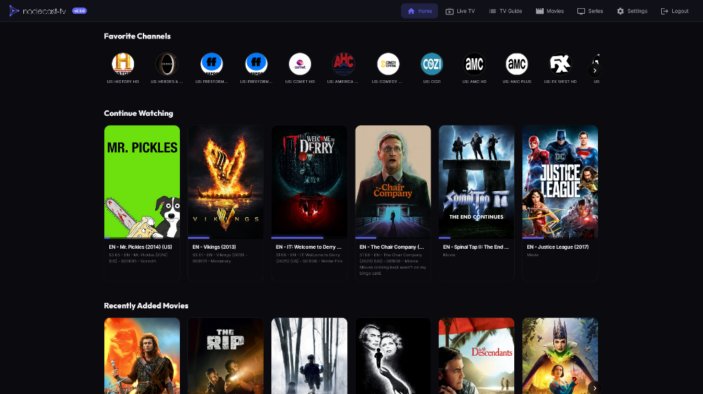
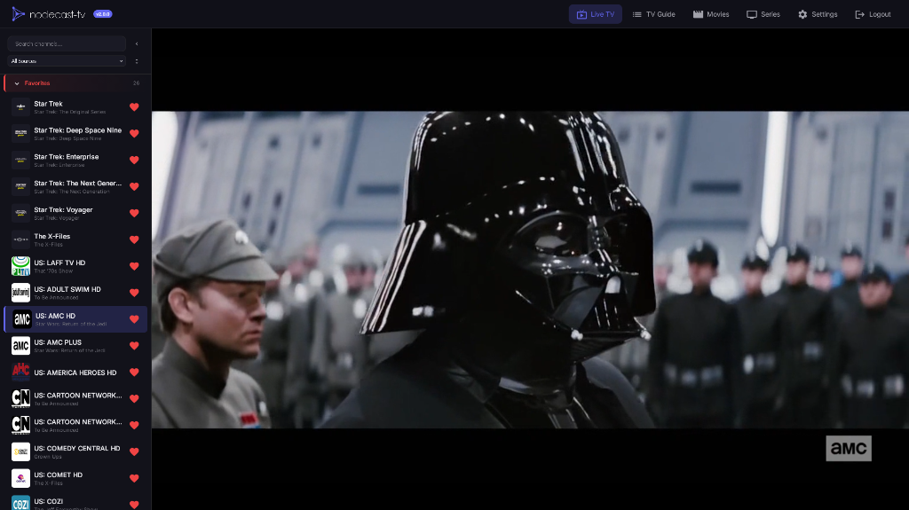
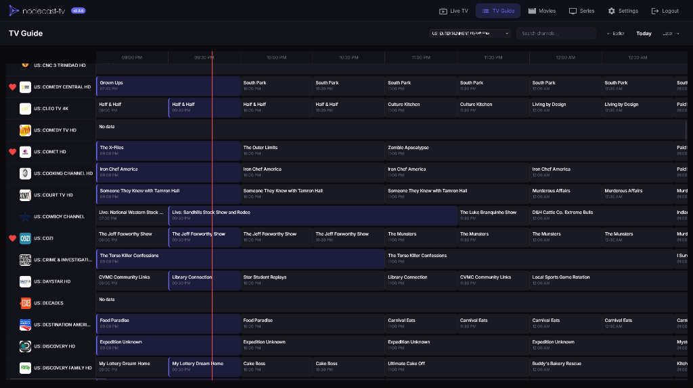
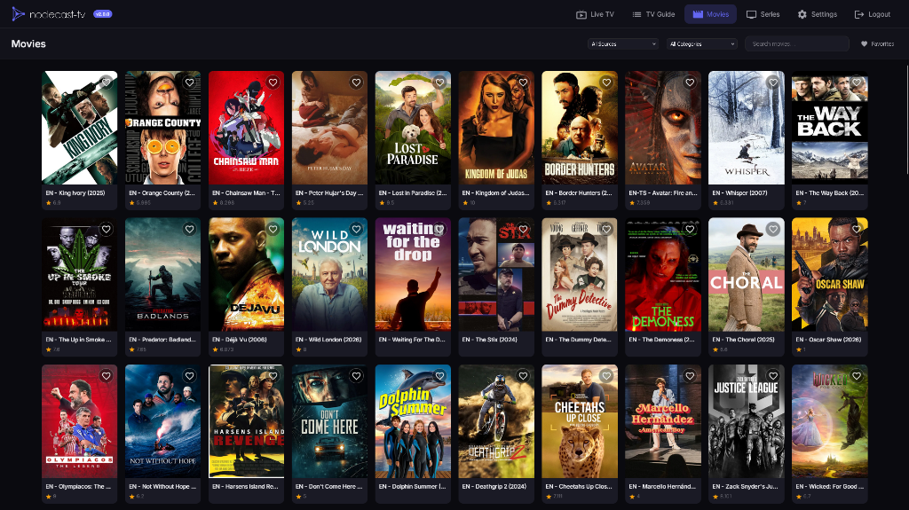
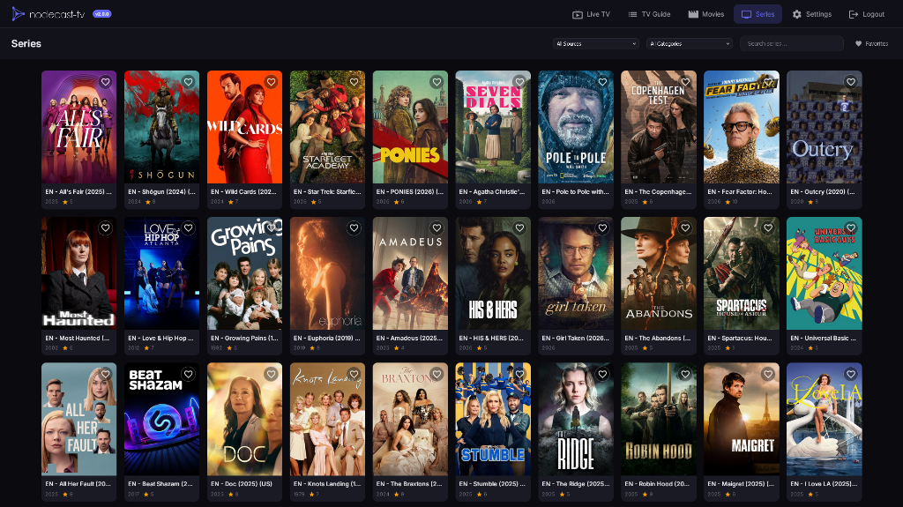
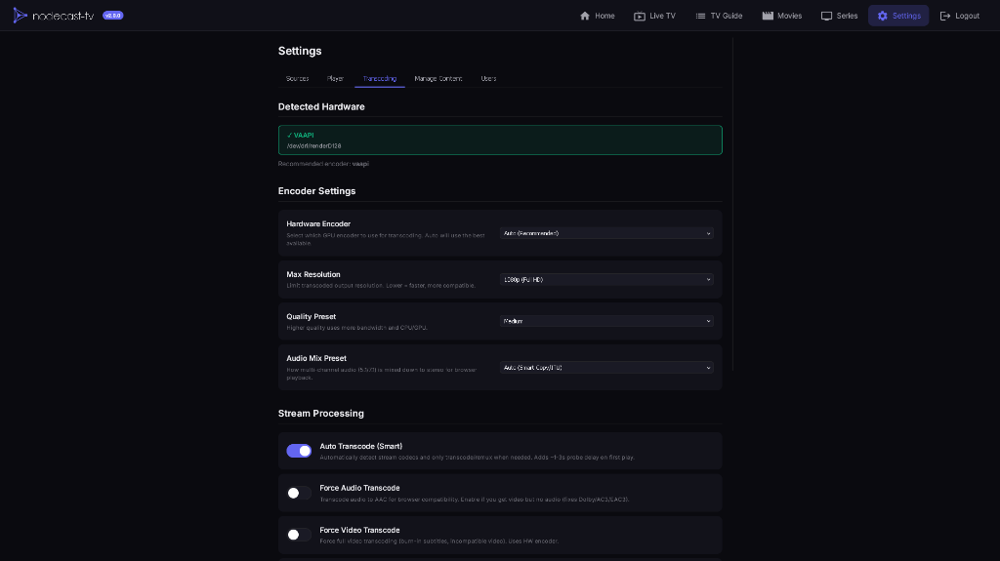

<p align="center">
  
</p>

# What is nodecast-tv?

nodecast-tv is a modern, web-based IPTV player featuring Live TV, EPG, Movies (VOD), and Series support. Built with performance and user experience in mind.

## Features

- **📺 Live TV**: Fast channel zapping, category grouping, and search.
- **📅 TV Guide (EPG)**: Interactive grid guide with 24h timeline, search, and dynamic resizing.
- **🎬 VOD Support**: Dedicated sections for Movies and TV Series with rich metadata, posters, and seasonal episode lists.
- **❤️ Favorites System**: Unified favorites for channels, movies, and series with instant synchronization.
- **🔐 Authentication**: User login system with admin and viewer roles ([details](https://github.com/technomancer702/nodecast-tv/pull/23)).
- **🆔 OIDC SSO**: Support for Single Sign-On via OIDC providers (Authentik, Keycloak, etc.).
- **⚡ High Performance**: Optimized for large playlists (7000+ channels) using virtual scrolling and batch rendering.
- **⚙️ Management**: 
  - Support for Xtream Codes and M3U playlists.
  - Manage hidden content categories.
  - Playback preferences (volume memory, auto-play).
- **🎛️ Hardware Transcoding**: GPU-accelerated transcoding with NVIDIA NVENC, AMD AMF, Intel QuickSync, and VAAPI support.
- **🔊 Smart Audio**: Configurable 5.1→Stereo downmix presets (ITU, Night Mode, Cinematic) with automatic passthrough for compatible sources.
- **📦 Stream Processing**: Auto-detection of stream codecs with smart remux/transcode decisions.
- **🐳 Docker Ready**: Easy deployment containerization.

## Screenshots

<div align="center">
  
  
  
  
  
  
</div>

## Getting Started

### Prerequisites

- Node.js (v14 or higher)
- npm

### Installation

1.  Clone the repository:
    ```bash
    git clone https://github.com/technomancer702/nodecast-tv.git
    cd nodecast-tv
    ```

2.  Install dependencies:
    ```bash
    npm install
    ```

3.  Start the development server:
    ```bash
    npm run dev
    ```

4.  Open your browser at `http://localhost:3000`.

### Docker Deployment

You can run nodecast-tv easily using Docker.

Container images are published to `ghcr.io/technomancer702/nodecast-tv` when a GitHub release is published. Use a version tag such as `v2.2.1` for the release: stable releases publish image tags `2.2.1`, `2.2`, and `latest`; prereleases publish their full version tag without updating `latest` or the minor-version alias. Branch pushes, tag pushes alone, and draft releases do not publish images.

1.  Create a `docker-compose.yml` file (or copy the one from this repo):

    ```yaml
    services:
      nodecast-tv:
        build: https://github.com/technomancer702/nodecast-tv.git#main
        container_name: nodecast-tv
        ports:
          - "3000:3000" # Host:Container
        volumes:
          - ./data:/app/data
        restart: unless-stopped
        environment:
          - NODE_ENV=production
          - PORT=3000 # Optional: Internal container port
    ```

2.  Run the container:
    ```bash
    docker-compose up -d
    ```

The application will be available at `http://localhost:3000`.

### Deploy with Easypanel

[Easypanel](https://easypanel.io) is a self-hosted Docker deployment platform, and nodecast-tv has a one-click deployment template there:

[![Deploy on Easypanel][easypanel-btn]][easypanel-deploy]

[easypanel-btn]: https://easypanel.io/img/deploy-on-easypanel-40.svg
[easypanel-deploy]: https://easypanel.io/templates/nodecast-tv

### Hardware Acceleration Setup

To enable hardware transcoding (NVENC, QSV, VAAPI), you must expose your host's GPU to the container.

**1. Intel (QSV) & AMD (VAAPI)**
Update your `docker-compose.yml` to map the DRI devices and add necessary groups (often required for permission):
```yaml
    devices:
      - /dev/dri:/dev/dri # Required for VAAPI/QuickSync/AMF (Linux)
    # group_add:       # Optional: Needed mainly if you run as non-root
    #   - "video"      # Run on host: getent group video
    #   - "render"     # Run on host: getent group render
```

**2. NVIDIA (NVENC)**
Ensure you have the [NVIDIA Container Toolkit](https://docs.nvidia.com/datacenter/cloud-native/container-toolkit/install-guide.html) installed on your host, then update your `docker-compose.yml`:
```yaml
    deploy:
      resources:
        reservations:
          devices:
            - driver: nvidia
              count: 1
              capabilities: [gpu, utility, video, compute]
```

**Verify:**
On Linux, QSV detection checks an accessible Intel render device and verifies a short H.264 encode with the configured FFmpeg. If that check fails, QSV is not automatically recommended. Ensure the container has read/write permission on the mapped device. The amd64 image includes the Intel Media SDK and VPL GPU runtimes for older and newer Intel GPUs. It also includes `pciutils` for systems where GPU vendor information is hidden in sysfs.

After restarting the container, go to **Settings -> Transcoding**. The **Hardware Detection** status should list your GPU (e.g., "NVIDIA GPU Detected" or "VAAPI Available").

### SSO / OIDC Setup

Enable Single Sign-On (SSO) with your preferred OIDC provider (Authentik, Keycloak, etc.) by configuring these variables in your `.env` file or Docker environment:

```env
OIDC_ISSUER_URL=https://your-idp.com/application/o/nodecast/
OIDC_CLIENT_ID=your_client_id
OIDC_CLIENT_SECRET=your_client_secret
OIDC_CALLBACK_URL=http://localhost:3000/api/auth/oidc/callback # Adjust for your domain
```

The app loads the provider's `/.well-known/openid-configuration` document at startup, using its published authorization, token and optional userinfo endpoints. Copy the provider's issuer URL exactly, including its trailing slash if present; the returned issuer must match. See the [OpenID Connect discovery specification](https://openid.net/specs/openid-connect-discovery-1_0.html#ProviderConfig).

`OIDC_AUTH_URL`, `OIDC_TOKEN_URL` and `OIDC_USERINFO_URL` can override individual endpoints. Supplying all three skips discovery. HTTPS issuers require HTTPS endpoints; HTTP is retained for local development configurations. Discovery has a five-second timeout and a 128 KiB response limit. If it fails, SSO returns an unavailable message and local login remains usable; correct the provider configuration and restart the app.

**Note:** New users signing in via SSO are automatically assigned the **Viewer** role. You must manually promote them to Admin if desired.

### Usage

1.  Go to **Settings** -> **Content Sources**.
2.  Add your IPTV provider details (Xtream Codes or M3U URL).
3.  Click "Refresh Sources".
4.  Navigate to **Live TV**, **Movies**, or **Series** to browse your content.


## Browser Codec Support & Transcoding

nodecast-tv is a web-based application. By default, **video decoding is handled by your browser**. However, the built-in **smart transcoding system** automatically converts incompatible media (e.g., HEVC video, Dolby audio) into browser-friendly formats using FFmpeg.

**Codec Compatibility Table:**

| Codec | Chrome | Firefox | Safari | Edge |
|-------|--------|---------|--------|------|
| **H.264 (AVC)** | ✅ | ✅ | ✅ | ✅ |
| **H.265 (HEVC)** | Auto-Transcode | Auto-Transcode | ✅ | ⚠️ |
| **AV1** | ✅ | ✅ | Auto-Transcode | ✅ |
| **AAC Audio** | ✅ | ✅ | ✅ | ✅ |
| **AC3/EAC3 (Dolby)** | Auto-Transcode | Auto-Transcode | ✅ | Auto-Transcode |

> **⚠️ Note:** Edge requires the [HEVC Video Extensions](https://apps.microsoft.com/store/detail/hevc-video-extensions/9NMZLZ57R3T7) from the Microsoft Store to play H.265 (HEVC) natively.
> **ℹ️ Note:** Safari plays AV1 natively on supported hardware (iPhone 15 Pro, M3 Macs). On older devices, Auto-Transcode handles it.


## Supported Stream Types

nodecast-tv is optimized for **HLS (HTTP Live Streaming)**.

-   **✅ HLS (`.m3u8`)**: Fully supported and recommended. Best for adaptive bitrate and network resilience.
-   **✅ MPEG-TS (`.ts`)**: Supported via Force Remux in settings.
-   **⚠️ High Latency/P2P**: For sources like Acestream, prefer HLS output (`.m3u8`) over raw TS streams to avoid timeouts during buffering.
-   **❌ RTMP/RTSP**: Not supported natively by browsers.

## Transcoding Settings

All transcoding and stream processing settings are found in **Settings → Transcoding**.

### Hardware Encoder

| Setting | Options | Description |
|---------|---------|-------------|
| **Hardware Encoder** | Auto, NVENC, AMF, QSV, VAAPI, Software | GPU-accelerated encoding. Auto detects best available. |
| **Max Resolution** | 4K, 1080p, 720p, 480p | Limit output resolution (lower = faster). |
| **Quality Preset** | High, Medium, Low | Encoding quality/speed tradeoff. |
| **Audio Mix Preset** | Auto, ITU, Night Mode, Cinematic, Passthrough | 5.1→Stereo downmix mode (see below). |

### Audio Mix Presets

| Preset | Description |
|--------|-------------|
| **Auto (Smart)** | Copies stereo AAC as-is, uses ITU downmix for 5.1+ |
| **ITU-R BS.775** | Industry-standard balanced downmix |
| **Night Mode** | Boosted dialogue, reduced bass for quiet viewing |
| **Cinematic** | Wide soundstage, immersive surround feel |
| **Passthrough** | No processing (may cause errors on 5.1/Dolby sources) |

### Stream Processing

| Setting | What It Does | When to Enable |
|---------|--------------|----------------|
| **Auto Transcode (Smart)** | Probes streams and only transcodes/remuxes when needed | Recommended for most users (default ON) |
| **Force Audio Transcode** | Transcodes audio to AAC (video passes through) | When you have video but no audio (Dolby/AC3/EAC3) |
| **Force Video Transcode** | Full transcode of both audio and video | For HEVC/VP9 sources on unsupported browsers |
| **Force Remux** | Remuxes MPEG-TS to MP4 (no re-encoding) | For raw `.ts` streams from middleware |
| **Stream Output Format** | HLS or TS for Xtream API requests | Try TS if HLS causes buffering |

### Network

| Setting | What It Does | When to Enable |
|---------|--------------|----------------|
| **Force Backend Proxy** | Routes streams through the server for CORS headers | When streams fail with CORS errors, or using middleware |


## Enigma2 / OpenWebif sources

Add the receiver's bouquet export URL (for example, `http://receiver/web/services.m3u?bRef=...`) as an M3U source. Program tags select the matching video/audio service during probing, remux and transcoding. Tagged raw streams are remuxed even when Force Remux is off.

For a single-tuner receiver, enable **Zap before streaming (Enigma2/OpenWebif)** on that source. The player releases its previous stream, tunes the configured receiver, and waits for the source's zap delay before starting playback. The default delay is 1500 ms; values from 0 to 10000 ms are supported. Stop and changing channels cancel pending playback startup. Live TV continues playing when you minimize the player and browse the guide or other pages. The receiver address comes from the administrator-managed source URL, and only imported channels can be tuned.

## Troubleshooting

### Video Won't Play (Black Screen or Loading Forever)

| Symptom | Likely Cause | Solution |
|---------|--------------|----------|
| Black screen, `Access-Control-Allow-Origin` error | CORS blocked | Enable **"Force Backend Proxy"** in Settings → Transcoding |
| Black screen with `MEDIA_ERR_DECODE` | Unsupported codec (HEVC/VP9) | Ensure **"Auto Transcode"** is enabled |
| Loading forever (no error) | Browser decoder stuck | Enable **"Force Video Transcode"** (overrides Auto detection) |

### No Audio (Video Plays Fine)

| Symptom | Likely Cause | Solution |
|---------|--------------|----------|
| No audio at all | Dolby/AC3/EAC3 audio | Enable **"Force Audio Transcode"** (overrides Auto detection) |
| Audio out of sync | Stream encoding issue | Try changing stream format to TS in Settings |

### Low-Pitched Audio During Commercials

On Chromium browsers (including Chrome, Brave, and Edge), the player refreshes the media decoder when playback crosses an HLS discontinuity, which is commonly used at ad transitions. This keeps the current playback position and subtitle selection, but may briefly rebuffer. Streams without discontinuity markers cannot use this workaround. If distortion persists, try Firefox or enable **Force Audio Transcode** in Settings.

### Buffering Issues

| Symptom | Likely Cause | Solution |
|---------|--------------|----------|
| Constant buffering | Slow network or weak GPU | 1. Lower **Max Resolution** (e.g. to 720p)<br>2. Try **TS** format instead of HLS |

### HTTPS / Reverse Proxy Issues

If you're running nodecast-tv behind a reverse proxy (Nginx, Caddy, Traefik) with HTTPS:

| Symptom | Likely Cause | Solution |
|---------|--------------|----------|
| Streams fail with `fragLoadError` | Mixed content (HTTPS page loading HTTP streams) | Enable **"Force Backend Proxy"** in Settings → Transcoding |
| Streams work on HTTP but not HTTPS | Reverse proxy not passing headers correctly | Ensure `X-Forwarded-Proto` header is set (see examples below) |

**Caddy example:**
```
tv.domain.com {
    reverse_proxy nodecast:3000 {
        flush_interval -1
        header_up X-Forwarded-Proto {scheme}
    }
}
```

**Nginx example:**
```nginx
location / {
    proxy_pass http://nodecast:3000;
    proxy_http_version 1.1;           # Required for chunked transfers and keep-alive
    proxy_buffering off;              # Don't buffer responses (required for streaming)
    proxy_request_buffering off;      # Don't buffer requests
    proxy_read_timeout 300s;          # VOD: 5 min timeout for large files
    proxy_connect_timeout 60s;        # VOD: Connection timeout
    client_max_body_size 0;           # No upload size limit
    proxy_set_header Host $host;
    proxy_set_header X-Real-IP $remote_addr;
    proxy_set_header X-Forwarded-For $proxy_add_x_forwarded_for;
    proxy_set_header X-Forwarded-Proto $scheme;  # Required for HTTPS detection
    proxy_set_header Connection "";   # VOD: Enable keep-alive for Range requests
}
```

### IPTV Middleware (m3u-editor, dispatcharr, Threadfin, xTeVe)
If you manage your streams with middleware tools, you may encounter CORS issues or raw MPEG-TS streams that browsers can't play directly.

**Recommended Setup:**
1.  **Force Backend Proxy:** Enable this in **Settings → Transcoding → Network**. This routes middleware streams through NodeCast TV, bypassing CORS restrictions.
2.  **Auto Transcode:** Keep this enabled (default). It will automatically detect if the middleware stream (e.g., MPEG-TS) needs to be remuxed or transcoded for the browser.

There is rarely a need to configure specific "Force Remux" settings manually anymore; the system detects stream types automatically.

### TVHeadend

If you're using TVHeadend as your source, you may need to configure a few settings for streams to play correctly in nodecast-tv:

**Option 1: Enable Force Backend Proxy (Easiest)**
- In nodecast-tv, go to **Settings → Transcoding → Network**
- Enable **"Force Backend Proxy"**
- This routes streams through the server, bypassing browser CORS restrictions

**Option 2: Configure TVHeadend CORS**
- In TVHeadend, go to **Configuration → General → Base → HTTP Server Settings**
- Add your nodecast-tv URL to **"CORS origin"** (e.g., `http://192.168.1.100:3000`)
- **Note:** You must include the protocol (`http://` or `https://`)

**Additional Tips:**
- Enable **"digest+plain"** authentication in TVHeadend if using username/password in the M3U URL
- Try different stream profiles (`?profile=pass` or `?profile=matroska`) if playback issues persist

### Acestream / P2P Streaming

If you are using `acestream-docker-home` or similar tools, it is **recommended** to use the HLS output format to reduce server load, though NodeCast TV can remux raw streams if needed.

-   **Recommended:** `http://proxy:6878/ace/manifest.m3u8?id=...` (HLS Playlist - Direct Play)
-   **Supported:** `http://proxy:6878/ace/getstream?id=...` (MPEG-TS - Requires Server Remuxing)

## Technology Stack

- **Backend**: Node.js, Express
- **Frontend**: Vanilla JavaScript (ES6+), CSS3
- **Database**: SQLite (via better-sqlite3) for high-performance data storage
- **Streaming**: HLS.js for stream playback
- **Transcoding**: FFmpeg (integrated for hardware/software transcoding)

## Project Structure

```
nodecast-tv/
├── public/              # Frontend assets
│   ├── css/             # Stylesheets
│   ├── js/              # Client-side logic
│   │   ├── components/  # UI Components (ChannelList, EpgGuide, etc.)
│   │   ├── pages/       # Page Controllers (Movies, Series, etc.)
│   │   └── api.js       # API Client
│   └── index.html       # Main entry point
├── server/              # Backend server
│   ├── routes/          # API Endpoints (proxy, transcode)
│   ├── services/        # Playlist parsers, SyncService, etc.
│   ├── db/              # Database Logic
│   │   ├── index.js     # Legacy DB Wrapper
│   │   └── sqlite.js    # SQLite Connection & Schema
│   └── index.js         # Server Entry Point
└── data/                # Persistent storage (content.db, playlists)
```

## Authentication and reverse proxies

Usernames are matched without regard to case, and their display spelling is preserved. If an older database has accounts differing only by case, those accounts still require their exact spelling until an administrator renames them; ambiguous mixed-case logins are rejected. New accounts and renames cannot create case-only duplicates.

Browser playback and API requests use an HttpOnly authentication cookie. API clients can also send the token returned by `/api/auth/login` as `Authorization: Bearer <token>`. Existing accounts and settings are retained, but clients must sign in again after upgrading from the older token format. Logout revokes that login; changing a password invalidates all of that account's existing tokens.

Random authentication secrets are created once in `data/security.json` and survive restarts. Keep that file with the persistent data volume. `JWT_SECRET` and `SESSION_SECRET` can override the generated secrets for managed deployments.

For reverse proxies, set `APP_ORIGIN` to the external origin (for example `https://tv.example.com`) and `TRUST_PROXY` to the proxy's IP address or CIDR when it is outside the default loopback/private networks. HTTPS requests receive Secure cookies; `AUTH_COOKIE_SECURE=true` enforces this when TLS is terminated upstream.

HTTP(S) media inputs reject control characters, local-file protocols, loopback and link-local/metadata addresses. Local IPTV services on ordinary LAN addresses remain supported. Set `ALLOW_LOCAL_MEDIA_URLS=true` when a provider deliberately runs on localhost; metadata addresses remain blocked. This URL validation complements deployment network restrictions; it does not resolve or pin every destination through nested FFmpeg requests.

## License

This project is licensed under the **GNU General Public License v3.0 (GPL-3.0)**.

You are free to:
-   **Run** the program for any purpose
-   **Study** how the program works and change it
-   **Redistribute** copies
-   **Distribute** copies of your modified versions

Under the condition that:
-   You typically must distinguish your modifications from the original work
-   You provide the source code to recipients
-   You license any derivative works under the same GPL-3.0 license

See the [LICENSE](LICENSE) file for details.
